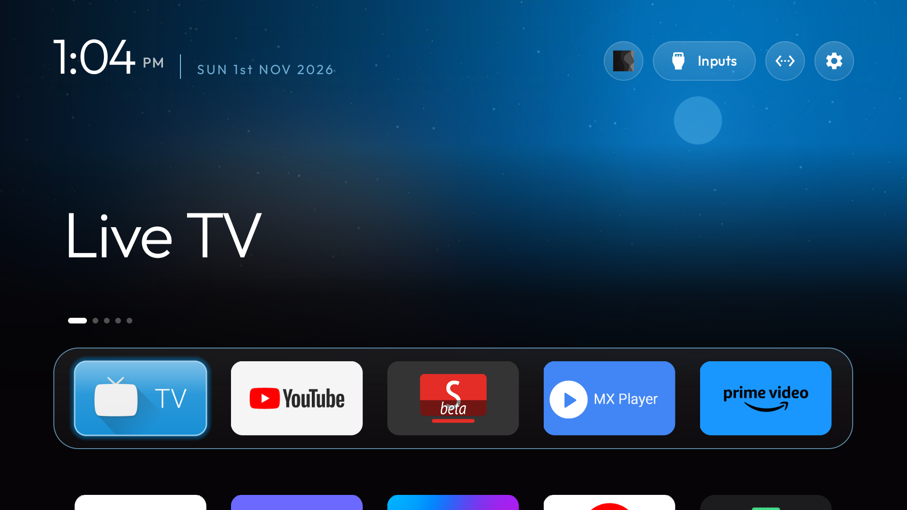
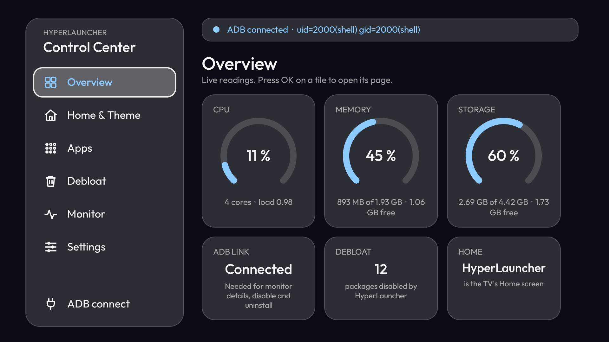

# HyperLauncher

An Android TV launcher with a built-in **Control Center**: watch CPU, memory and storage, manage and uninstall
apps, debloat ads and preloaded junk, and restyle the home screen. Everything is reversible, and you can go back to
your TV's stock home screen at any time.





## What it does

| | |
|---|---|
| **Home screen** | Customize Launcher: apps per row, row spacing, animations, colour effects, greeting, date format, wallpapers (stock, colour, or a picture from USB), accent colour, style packs, hidden apps, long-press Reorder / App info / Hide |
| **Monitor** | Live CPU, memory and storage, a rolling chart, top apps by memory |
| **Apps** | Icon grid; Open, Force stop, App info, Disable, Uninstall |
| **Debloat** | A catalog of ad, analytics, background and bloatware packages. Select, disable, and undo. Nothing is uninstalled by the catalog |
| **Safety** | A snapshot is taken before the first change. **Restore everything** puts every package and setting back |

## Install in 3 steps

You need a PC with `adb`, JDK 17 and the Android SDK (or an APK, see below), on the same network as the TV.

1. On the TV: Settings > Device Preferences > About > press *Build* 7 times, then in *Developer options* turn on
   **USB debugging** and **Network debugging**. Note the TV's IP address.
2. On the PC:

   ```bash
   git clone https://github.com/bypreetham/hyperlauncher-cvt && cd hyperlauncher-cvt
   ./install.sh 192.168.1.50          # Windows PowerShell: .\install.ps1 192.168.1.50
   ```

3. Accept the **Allow USB debugging?** prompt on the TV (tick *Always allow*). The Control Center opens.
   Go to **Settings > Start HyperLauncher on start** to make it your Home.

### Two editions

| | **Full** (default) | **Lite** (`--lite`) |
|---|---|---|
| Launcher, Customize Launcher, wallpapers, hidden apps | yes | yes |
| Monitor: memory and storage | yes | yes |
| Monitor: CPU, top apps | yes | no (Android hides them from apps) |
| Apps: Open, App info | yes | yes |
| Apps: Force stop, Disable, uninstall system apps | yes (network ADB) | no |
| Uninstall an app you installed | yes | yes, through Android's own dialog |
| Debloat and Restore everything | yes (network ADB) | no |
| Needs Network debugging on the TV | yes | **no** |
| `INTERNET` permission | yes (only to reach the TV's own ADB) | **none** |

Lite is built without the ADB client at all, so nothing in it can open a connection. Build it with
`./install.sh 192.168.1.50 --lite` (`.\install.ps1 192.168.1.50 -Lite`). Installing still needs a way to sideload (`adb`, or any
file-manager install); running it does not.

With the Full edition, Network debugging opens port 5555 to your whole home network while it is on. The Control Center has a
**Network debugging** card (Settings) with a *Turn off* button, so switch it off when you are done cleaning.

Already have an APK? `./install.sh 192.168.1.50 path/to/app-debug.apk` skips the build and needs only `adb`.

## Install Lite (no network debugging)

The Lite edition never needs Network debugging, on the TV or in the app. To install it without turning debugging on either:

1. On a PC, build the APK: `./gradlew :app:assembleLiteDebug` (JDK 17 and the Android SDK). It ends up in `app/build/outputs/apk/lite/debug/app-lite-debug.apk`.
2. Copy the APK to a USB stick, plug it into the TV and open it with the TV's file manager (allow *Install unknown apps* for that file manager when asked).
3. Open HyperLauncher, go to **Settings > Start HyperLauncher on start** and pick it as the Home screen in the TV's own settings.

If you already use `adb`, `./install.sh <TV_IP> --lite` does steps 1 to 3 in one go, but that needs Network debugging on for the install only.

Checked on a Xiaomi Mi TV (MiTV-AXSO2, Android TV 11): the Lite build installs over the Full one, the Control Center opens with the Overview and Apps (Open, App info, Uninstall) pages with no Debloat or ADB entries, the Home key opens HyperLauncher, and after a reboot the Home key still opens it. Its APK has no `INTERNET` permission.

## Use it by hand

Everything is in the Control Center (Home screen, top bar, or the app list):

- **Home & Theme**: Customize Launcher, go to home, revert to the stock launcher, restore everything.
- **Debloat**: *Select recommended*, then *Disable selected*. *Restore everything* undoes it all.
- **Settings**: start HyperLauncher when the TV starts.

The app talks to the TV's own ADB on `127.0.0.1:5555`, so it needs Network debugging switched on. Without it, listing,
opening apps and the launcher's own settings still work; disabling and uninstalling system apps do not.

## Use it with an AI assistant

Any coding agent (Claude Code, Gemini CLI, Antigravity, Codex, Cursor ...) can run the install and the cleanup for you.
Open the cloned folder in it and say:

> Read AGENTS.md. Install HyperLauncher on my TV at 192.168.1.50, back it up, then disable the recommended debloat
> packages and tell me what you changed.

[AGENTS.md](AGENTS.md) holds the commands and the safety rules, so no assistant-specific setup is needed.

## Going back

- **Revert to the stock home screen**: Control Center > Home & Theme.
- **Undo everything**: Control Center > Debloat > RESTORE EVERYTHING (re-enables packages, reinstalls ones removed
  for the user, restores ad and DNS settings).
- **Uninstall**: `adb -s 192.168.1.50:5555 uninstall com.hyperlauncher.tv` after restoring.

## Notes

- Android 11+ *Wireless debugging* (random port, pairing code) is not supported; use *Network debugging* on port 5555.
- Some Xiaomi / Mi TV firmware sends the Home button to its own launcher; HyperLauncher disables that stock launcher
  (not removes it) when you turn on *Start HyperLauncher on start*, and *Restore everything* brings it back.
- Debug-signed builds, minSdk 26, built with AGP 8.5 / Gradle 8.9 (JDK 17): `:app:assembleFullDebug` and `:app:assembleLiteDebug`.

## Credits and license

MIT, see [LICENSE](LICENSE). The launcher is a fork of the MIT-licensed CleanYourTV launcher by Gathin; see
[THIRD_PARTY_NOTICES.md](THIRD_PARTY_NOTICES.md).
